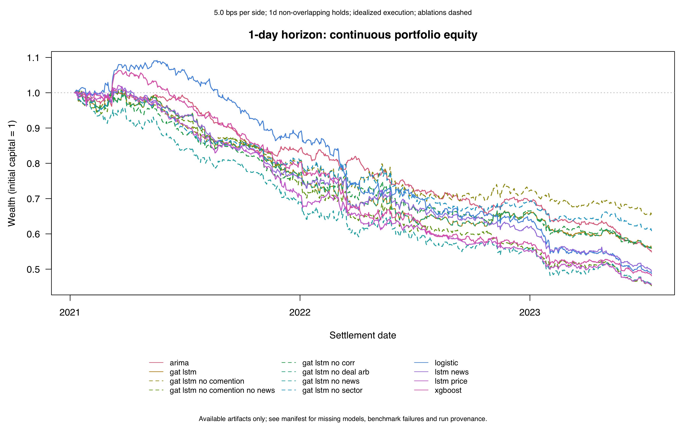
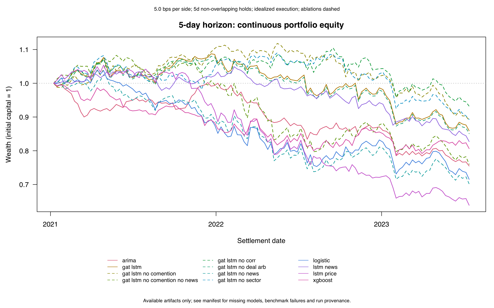
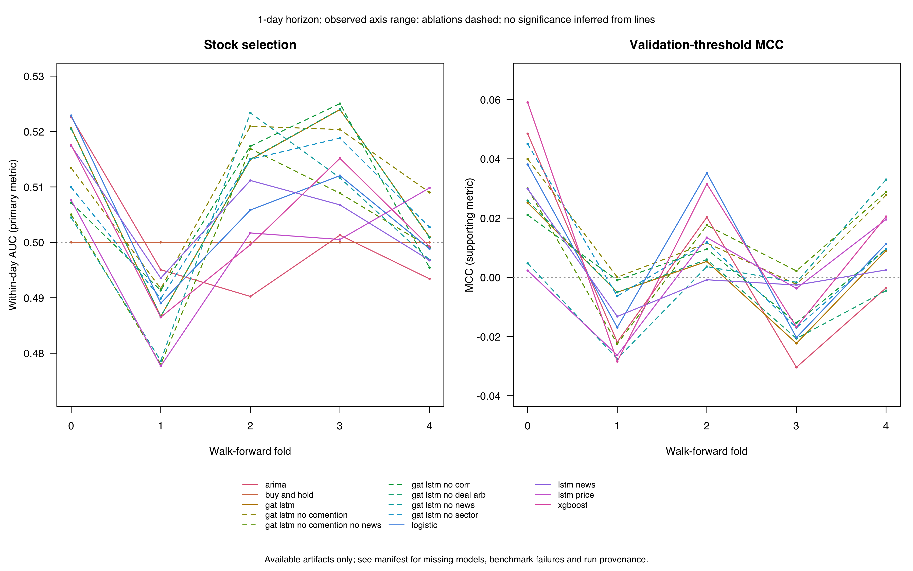
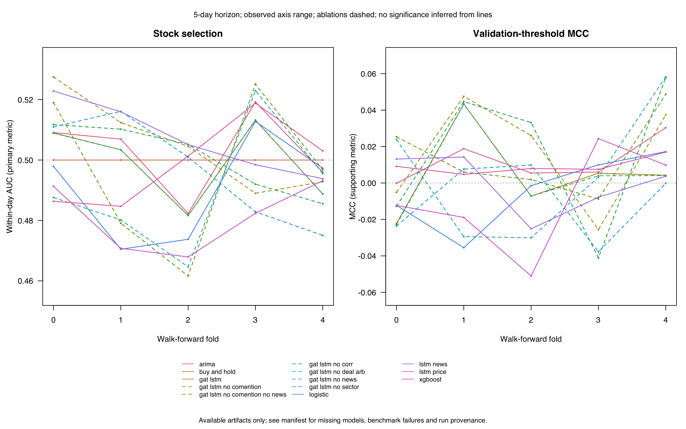

# Results

> Owner: Evaluation · Issue #50 · Due Fri 20 Nov

<!-- Main table, proposed vs Baseline 6 significance, ablations (#41), equity curves. -->

## Held-out model comparison

The three neural models use the official T1 runs at seed 42. Tables 1 and 2
give the unweighted fold means for classification and the continuous net Sharpe
for each horizon. All models share the same 64,082 eligible observations at
1 day and 64,070 at 5 days. The constant Buy-and-Hold forecast gives an
undefined MCC. Its portfolio Sharpe is unavailable for both horizons.
[Task 4.10 comparison scores](../../results/comparison_with_classical/tables/model_comparison.csv)

**Table 1. Held-out metrics at the 1-day horizon.**

| Model | Accuracy | F1 | MCC | Within-day AUC | Net Sharpe |
| --- | ---: | ---: | ---: | ---: | ---: |
| Buy-and-Hold | 0.5057 | 0.6716 | N/A | 0.5000 | N/A |
| ARIMA | 0.4925 | 0.4719 | 0.0026 | 0.5005 | -2.7774 |
| Logistic Regression | 0.4999 | 0.5065 | 0.0095 | 0.5057 | -2.2162 |
| XGBoost | 0.5054 | 0.6034 | 0.0132 | 0.5036 | -2.5100 |
| LSTM Price Only | 0.4930 | 0.4334 | 0.0010 | 0.4995 | -2.6899 |
| LSTM + News, No Graph | 0.5032 | 0.4962 | 0.0032 | 0.5051 | -2.4323 |
| **Proposed GAT-LSTM** | 0.4994 | 0.3934 | 0.0024 | 0.5094 | -1.7502 |

**Table 2. Held-out metrics at the 5-day horizon.**

| Model | Accuracy | F1 | MCC | Within-day AUC | Net Sharpe |
| --- | ---: | ---: | ---: | ---: | ---: |
| Buy-and-Hold | 0.5213 | 0.6844 | N/A | 0.5000 | N/A |
| ARIMA | 0.5114 | 0.5273 | 0.0121 | 0.5027 | -1.2366 |
| Logistic Regression | 0.5033 | 0.4378 | -0.0044 | 0.4904 | -0.9561 |
| XGBoost | 0.5082 | 0.5204 | 0.0093 | 0.4988 | -0.8439 |
| LSTM Price Only | 0.5023 | 0.6145 | -0.0096 | 0.4811 | -1.3398 |
| LSTM + News, No Graph | 0.4986 | 0.4853 | -0.0004 | 0.5072 | -0.9806 |
| **Proposed GAT-LSTM** | 0.5040 | 0.5575 | 0.0047 | 0.4992 | -0.5506 |

At 1 day, GAT-LSTM had the highest within-day AUC (0.5094), ahead of
Logistic Regression (0.5057) and Baseline 6 (0.5051). At 5 days, Baseline 6
led (0.5072), followed by ARIMA (0.5027), with GAT-LSTM at 0.4992.
Relative to Baseline 6, GAT-LSTM had lower accuracy, F1 and MCC at 1 day
and higher values on all three metrics at 5 days. These threshold-dependent
scores describe a different aspect of performance from within-day ranking.

All six core long/short strategies had negative cumulative net returns and
negative net Sharpe at both horizons. GAT-LSTM had the highest net Sharpe
among them at both horizons (-1.7502 and -0.5506), but its net wealth
declined by 44.11% and 14.08%, respectively. The full-period Buy-and-Hold
basket remains unavailable because of unresolved ALXN and XLNX valuation
cases. Figures 1 and 2 show continuous long/short portfolio wealth, with
ablations drawn as dashed lines.
[Equity series](../../results/comparison_with_classical/tables/equity_curves.csv) ·
[Benchmark availability](../../results/comparison_with_classical/tables/buy_and_hold_benchmark.csv)

*Figure 1. One-day continuous portfolio wealth by settlement date, net of trading
costs and normalized to one at inception.*

*Figure 2. Five-day continuous portfolio wealth under the common non-overlapping
holding schedule, net of trading costs.*

Figures 3 and 4 show how the two main classification endpoints vary by fold.
Buy-and-Hold contributes to the within-day AUC panels only because its MCC
is undefined.

*Figure 3. One-day within-day AUC and validation-threshold MCC across the five
test folds.*

*Figure 4. Five-day within-day AUC and validation-threshold MCC across the five
test folds. The plots show descriptive fold variation.*

## Ablation study

Tables 3 and 4 compare the full model with six T1 variants. The seed-42
predictions match the official evaluation population in every fold and horizon.
The six ablation run records identify training commit `b5a88ed9`, while the
official neural comparison uses `dd811f1c`. The cross-commit comparisons
are descriptive and cannot isolate the causal contribution of the removed
components. The multi-seed column gives the mean and minimum–maximum of the
five-fold within-day AUC at seeds 42, 43 and 44.
[Task 3.9 ablation records](../../results/tables/ablations_3_9.jsonl) ·
[Comparison manifest](../../results/comparison_with_classical/tables/comparison_manifest.json)

**Table 3. Ablation results at the 1-day horizon.**

| Variant | Within-day AUC (seed 42) | Fold ROC AUC (seed 42) | MCC (seed 42) | Within-day AUC across seeds, mean (range) |
| --- | ---: | ---: | ---: | ---: |
| Proposed (full model) (`gat_lstm`) | 0.50942 | 0.4996 | 0.0024 | 0.50651 (0.50357–0.50942) |
| Drop news features (`gat_lstm_no_news`) | 0.50299 | 0.4990 | 0.0024 | 0.50238 (0.49833–0.50582) |
| Drop sector (`gat_lstm_no_sector`) | 0.50728 | 0.5041 | 0.0086 | 0.50521 (0.50383–0.50728) |
| Drop corr (`gat_lstm_no_corr`) | 0.50726 | 0.5011 | 0.0048 | 0.50544 (0.50395–0.50726) |
| Drop comention (`gat_lstm_no_comention`) | 0.51109 | 0.5084 | 0.0154 | 0.50739 (0.50343–0.51109) |
| Drop deal-arb corr pairs (`gat_lstm_no_deal_arb`) | 0.50941 | 0.4995 | 0.0003 | 0.50650 (0.50356–0.50941) |
| Drop news features and comention (`gat_lstm_no_comention_no_news`) | 0.50159 | 0.5005 | 0.0112 | 0.50244 (0.50142–0.50433) |

**Table 4. Ablation results at the 5-day horizon.**

| Variant | Within-day AUC (seed 42) | Fold ROC AUC (seed 42) | MCC (seed 42) | Within-day AUC across seeds, mean (range) |
| --- | ---: | ---: | ---: | ---: |
| Proposed (full model) (`gat_lstm`) | 0.49918 | 0.5054 | 0.0047 | 0.49875 (0.49711–0.49996) |
| Drop news features (`gat_lstm_no_news`) | 0.49018 | 0.4931 | 0.0052 | 0.49525 (0.49013–0.50545) |
| Drop sector (`gat_lstm_no_sector`) | 0.49719 | 0.5024 | -0.0088 | 0.49961 (0.49719–0.50138) |
| Drop corr (`gat_lstm_no_corr`) | 0.50094 | 0.5090 | 0.0164 | 0.50100 (0.49832–0.50374) |
| Drop comention (`gat_lstm_no_comention`) | 0.50525 | 0.5086 | 0.0161 | 0.50351 (0.50103–0.50525) |
| Drop deal-arb corr pairs (`gat_lstm_no_deal_arb`) | 0.49918 | 0.5054 | 0.0043 | 0.49863 (0.49689–0.49982) |
| Drop news features and comention (`gat_lstm_no_comention_no_news`) | 0.49634 | 0.5046 | 0.0147 | 0.50000 (0.49549–0.50818) |

Removing news features removes the news flag, sentiment, confidence and
embeddings. The seed-42 within-day AUC and the multi-seed mean were lower
at both horizons when news features alone were removed. Removing sector
edges lowered the seed-42 score at both
horizons, while the multi-seed mean was lower at 1 day and slightly higher
at 5 days. Removing correlation edges lowered within-day AUC at 1 day and
raised it at 5 days, both at seed 42 and on average across seeds. Removing
co-mention edges increased within-day AUC at both horizons in the seed-42
and multi-seed summaries, with a larger difference at 5 days.

Removing the ADI–MXIM, AMD–XLNX and AZN–ALXN deal-arbitrage pairs from the
correlation edges made little difference to within-day AUC at either horizon.
The combined variant removes news features and co-mention edges while
retaining sector and correlation edges. Its across-seed mean was below the
full model at 1 day and slightly above it at 5 days, even though its seed-42
score was lower at both horizons. The observed ranges describe sensitivity
to the three documented seeds.
[Task 3.9 ablation summary](../../results/tables/ablations_3_9.md)

## Proposed model versus Baseline 6

The following are production results for the official tuned T1 runs at seed 42,
from [`significance_mcc.json`](../../results/tables/significance_mcc.json). Both runs
record training commit `dd811f1ca50ce748ef542fa5d1e9b8cd2247cd03`. The comparison uses
exactly matched evaluation keys and realised labels across all five folds for each
horizon. MCC uses each model's own recorded validation-selected threshold. The
statistical procedure and its assumptions are described in the Evaluation protocol.

### Per-fold MCC

Differences are GAT-LSTM minus Baseline 6. MCC values and differences are rounded to
six decimal places from the full-precision artifact.

| Horizon | Fold | Matched observations | GAT-LSTM MCC | Baseline 6 MCC | Paired difference |
|---|---:|---:|---:|---:|---:|
| 1d | 0 | 12,852 | 0.025179 | 0.029907 | -0.004728 |
| 1d | 1 | 12,837 | -0.005045 | -0.013214 | +0.008170 |
| 1d | 2 | 12,829 | 0.005378 | -0.000814 | +0.006193 |
| 1d | 3 | 12,838 | -0.022290 | -0.002602 | -0.019688 |
| 1d | 4 | 12,726 | 0.009017 | 0.002496 | +0.006521 |
| 5d | 0 | 12,852 | -0.022250 | 0.013153 | -0.035403 |
| 5d | 1 | 12,829 | 0.043398 | 0.014243 | +0.029155 |
| 5d | 2 | 12,825 | -0.007209 | -0.025135 | +0.017926 |
| 5d | 3 | 12,838 | 0.005369 | -0.007835 | +0.013204 |
| 5d | 4 | 12,726 | 0.004262 | 0.003727 | +0.000535 |

### Paired inference across folds

Each mean difference gives equal weight to the five folds. The 95% intervals are
secondary paired whole-fold bootstrap intervals; p-values are from the primary
exact two-sided sign-flip test. Holm adjustment accounts for the two horizons.

| Horizon | Matched observations | Mean MCC difference | 95% bootstrap interval | Raw p-value | Holm-adjusted p-value |
|---|---:|---:|---|---:|---:|
| 1d | 64,082 | -0.000707 | [-0.011124, +0.007115] | 1.0000 | 1.0000 |
| 5d | 64,070 | +0.005083 | [-0.015960, +0.021473] | 0.6875 | 1.0000 |

### Interpretation and limitations

GAT-LSTM has a slightly lower average fold MCC at 1 day and a slightly higher one
at 5 days. Neither horizon rejects the null under the specified sign-flip procedure
at family-wise alpha 0.05; both adjusted p-values are 1.0000. Both descriptive
bootstrap intervals include zero. These findings do not establish equivalence,
prove the absence of a graph effect, or demonstrate superiority at either horizon.

Only five fold differences are available, and the minimum attainable two-sided
p-value is 0.0625. Shared training data and temporal dependence further limit the
interpretation of folds as independent evidence, particularly for overlapping
five-day outcomes. The intervals have uncertain small-sample coverage. These are
MCC results for a single training seed and configuration, not a significance test
of headline within-day AUC or a measure of variability across seeds. Original
training-input dataset hashes are unavailable, although the source prediction and
run-record hashes are preserved with the results.

## Retrospective LSTM tuning results

Task 4.13 completed 120 validation fits across two baselines, six candidates,
five folds and two horizons. Table 5 reports validation fold means by horizon
and the selection score across both horizons. The shared candidate grid uses
hidden size 64 and has no attention heads. T1 was selected for both models
with eight batch days, a learning rate of 0.001 and dropout of 0.1. Its
selection scores were 0.511809 for LSTM Price Only and 0.520949 for LSTM + News,
No Graph. These are retrospective validation results. The held-out scores
in Tables 1 and 2 come from the separately documented Task 4.10 predictions.
[Task 4.13 tuning summary](../../results/tables/tuning_baselines.md) ·
[Validation run manifest](../../results/tables/tuning_baselines_runs/manifest.json)

**Table 5. Retrospective validation scores by baseline and configuration.**

| Baseline | Candidate | Batch days | Learning rate | Dropout | Val. MCC 1d | Val. MCC 5d | Val. within-day AUC 1d | Val. within-day AUC 5d | Selection score |
|---|---|---:|---:|---:|---:|---:|---:|---:|---:|
| lstm_price | T0 | 32 | 1e-03 | 0.1 | 0.033714 | 0.021790 | 0.517311 | 0.492780 | 0.505046 |
| lstm_price | **T1** | 8 | 1e-03 | 0.1 | 0.033521 | 0.009902 | 0.522691 | 0.500926 | 0.511809 |
| lstm_price | T2 | 8 | 3e-04 | 0.1 | 0.030287 | 0.032873 | 0.518852 | 0.498420 | 0.508636 |
| lstm_price | T3 | 8 | 1e-04 | 0.1 | 0.038112 | 0.040912 | 0.515344 | 0.494065 | 0.504704 |
| lstm_price | T4 | 16 | 3e-04 | 0.1 | 0.036274 | 0.038414 | 0.516950 | 0.496425 | 0.506688 |
| lstm_price | T5 | 8 | 3e-04 | 0.3 | 0.034580 | 0.033019 | 0.518668 | 0.498309 | 0.508489 |
| lstm_news | T0 | 32 | 1e-03 | 0.1 | 0.039124 | 0.034750 | 0.516049 | 0.498619 | 0.507334 |
| lstm_news | **T1** | 8 | 1e-03 | 0.1 | 0.038280 | 0.027626 | 0.522456 | 0.519442 | 0.520949 |
| lstm_news | T2 | 8 | 3e-04 | 0.1 | 0.037796 | 0.035427 | 0.515880 | 0.516864 | 0.516372 |
| lstm_news | T3 | 8 | 1e-04 | 0.1 | 0.027106 | 0.034565 | 0.508991 | 0.518816 | 0.513903 |
| lstm_news | T4 | 16 | 3e-04 | 0.1 | 0.036322 | 0.035084 | 0.513324 | 0.516067 | 0.514695 |
| lstm_news | T5 | 8 | 3e-04 | 0.3 | 0.037257 | 0.035088 | 0.516103 | 0.516981 | 0.516542 |
